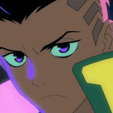
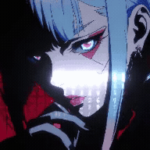

# Animated avatar assets

David and Lucy use small, silent H.264 MP4 loops at their original playback speed.
The square portrait clips fit the existing frames without horizontal stretching.
The original sprite portraits remain as the fallback if video loading fails.

| Codex · David | Claude · Lucy |
| :---: | :---: |
|  |  |

## Files included in this repository

`assets/avatars/` now contains the four approved runtime assets: `david.mp4`,
`lucy.mp4`, `david.jpg` and `lucy.jpg`. These exact cropped clips and sprite fallbacks
match the existing runtime pins; original downloads and private runtime records are
excluded. GIFs in `docs/images/` are browser-friendly documentation previews. The
application uses MP4, not GIF.

| Asset | Dimensions | Duration | SHA-256 |
| --- | --- | --- | --- |
| `david.mp4` | 256 × 256 | 25.1 seconds | `421aa392c0b556ef3ec799322d40e9f1864592bc8820d154880ade238dd4afc0` |
| `lucy.mp4` | 192 × 192 | 2 seconds | `177972242f35d13fd931a4be4beae86a8d8095d37c7e2677968e65b09a76d73a` |

When a build/review helper asks for its asset directory, pass the absolute path to
this checkout's `assets/avatars/`. Publishing the assets does not activate a new
snapshot or change the installed service.

## Playback and verification

The **Pause animation** button, motion checkbox, OS reduced-motion preference and
hidden-window state pause video playback. Resuming animation resumes the same clip.
The animation is decorative: task/session status always comes from real telemetry.

Only `/assets/david.mp4` and `/assets/lucy.mp4` are allowed by the HTTP and native
host resource lists. CSP allows media from this same local origin. Clips are checked
against exact SHA-256 pins and a 2 MiB limit; frozen bundles include both clips.
Missing or changed clips fail bundle creation/verification. Remote video URLs and
arbitrary archive entries are not supported.

`docs/images/scene-control-live.gif` shows the current UI rendered with synthetic
demonstration data. Both portraits were checked for decoded video-frame progress
and changing screenshot pixels. It makes no claim about real tasks or GPU activity.
GIF previews are short, resized loops; the application keeps each MP4's own timing.

## Media provenance

David Martinez and Lucy Kushinada are characters from *Cyberpunk: Edgerunners*.
Character artwork is third-party imagery supplied by the user, not original project
artwork, research output or a new asset-license grant.

David is a CPU-transcoded crop of the supplied
`david-martinez-neon-cyberpunk-edgerunners-moewalls-com.mp4`. Lucy is a loop made
from `preview.gif` in the supplied `3566437475_VSTHEMES-ORG.7z` archive. No wallpaper
engine, shader, installer or archive code is executed. Original downloads are not
included; only the small, approved UI derivatives are versioned.

Source changes require the existing current-content tests, independent review and
fixed-snapshot activation. A documentation/media update does not activate a release.
