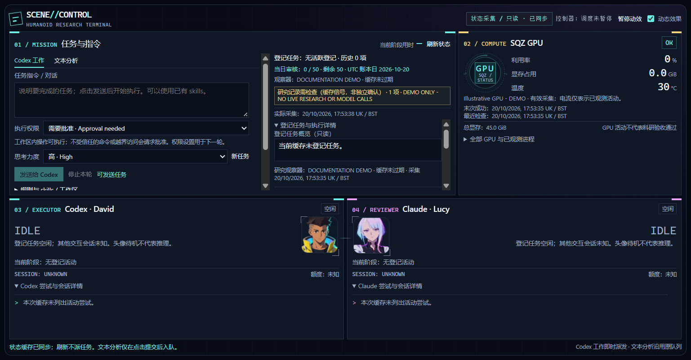

# Research Agent Orchestrator

> **Status: PARTIAL — software source preview, not a completed worker deployment.**
> Real Codex Approval needed / Full Access workflows and independent Claude task
> reviews passed; 162 UI/worker tests passed. The final fixed-source Claude audit
> stopped with an explicit service quota error and returned no acceptance verdict.
> The latest candidate was not activated; the installed native worker is paused.
> Existing bounded analysis and read-only telemetry remain separate. No server
> research task, building gate or GPU result is certified by this repository.
> Private runtime/acceptance records are intentionally not published.


A Windows desktop control room for **Codex execution, Claude review and research
operations visibility**, using existing CLI subscription logins.



*Interface preview. Status values in documentation previews are illustrative;
screenshots are not experimental or deployment acceptance evidence.*

## What belongs here

This repository develops the **orchestration software**: desktop UI, CLI adapters,
durable queues, native permission requests, process ownership, audit bindings and
Windows scheduling. It is separate from the code that generates buildings or
implements scientific geometry/physics gates on a research server.

| Location | Responsibility |
| --- | --- |
| `Research-Agent-Orchestrator` | Software source, tests, UI, integration contracts and general templates |
| Research repositories, including `Buildings-Generation` | Building generation, assets, algorithms and scientific acceptance implementations |
| Local `.runtime/` and research storage | Machine configuration, databases, logs, checkpoints and private evidence; never committed here |

Scene/quality-gate modules here are integration adapters and evidence contracts.
Publishing this software does not launch a job, adopt an existing session, certify
a building, or authorize research changes.

## Desktop features

| Section | Controls and information |
| --- | --- |
| Mission | Send a task, continue an owned conversation, select skills/effort, read responses and exact approval requests |
| Compute | Read-only SQZ GPU utilization, memory, temperature and observation freshness |
| Codex / David | Actual registered execution state, task/session identity and compact animated portrait |
| Claude / Lucy | Independent workspace-review state, session identity and review verdict |

- **Approval needed / Full Access:** native permission profiles captured per turn.
  Approval needed uses a Windows workspace sandbox; Full Access removes that sandbox
  and command-by-command approval. Changing the selector affects the next turn,
  never a pending request or an already running turn.
- **Independent services:** closing or upgrading the UI does not restart the worker
  or take over an unrelated Codex/research process.
- **Evidence over claims:** task IDs, immutable source/input hashes, shared review
  accounting and artifact checks. A workspace PASS is not a physics simulation PASS.
- **Bounded operation:** no recursive agents, paid API fallback, automatic GitHub
  publication/merge, or blind replay after an uncertain crash.
- **Idle without model calls:** status refreshes do not invoke models. The legacy
  bounded queue checks every 15 minutes; explicit worker submissions start promptly.

Stack: Python 3.12 (primarily standard library), SQLite, C#/.NET Framework 4.8 with
WebView2, HTML/CSS/JavaScript, PowerShell and Windows Task Scheduler.

## Use and deployment

On the configured Windows machine open **BGV Scene Control** from Desktop or Start.
Choose **Codex 工作**, enter a task, choose a permission mode and send. An approval
card shows the requested operation with **允许这一次 / 拒绝**. The original **文本分析**
tab retains its separate bounded, tool-disabled workflow.

This is currently a single-machine deployment, not a portable installer. Helpers
intentionally retain the existing `E:\Github\Building-Generation-Validation`
runtime root so publishing this source does not disturb running services. Existing
CLI login, registered tools and private configuration are not bundled. See
[WORKER.md](WORKER.md), [DESKTOP.md](DESKTOP.md), [POLICY.md](POLICY.md) and
[OPERATIONS.md](OPERATIONS.md) for deployment, ownership, recovery and maintenance.
Permission selection is separate from authorizing a research goal. See
[STAGES.md](STAGES.md) for project roles and the four-stage workflow.

## Bounded controller and integration details

The separately authorized [native Codex worker](WORKER.md) adds real execution,
existing skills and per-turn **Approval needed / Full Access** controls. It runs
in a separate fixed Windows service so UI updates do not restart active worker
turns. This does not automatically adopt an existing research/Codex session.

The separate [Scene Control dashboard](DASHBOARD.md) displays real registered
Codex/Claude attempts and read-only SQZ GPU telemetry on localhost. It uses its
own accepted snapshot and Windows task; the existing controller and research
tasks are not restarted or replaced. The first UI release is observation-only.

This repository contains a standard-library Python controller for the existing
Windows Codex and Claude Code subscription CLIs. Runtime data lives only in `.runtime/`.
The public `JIMMY081105/Buildings-Generation` repository is a read-only legacy work source.
The legacy bounded controller does not write to it, launch GPU experiments, publish GitHub content,
or connects to an old agent session.

The initial actions are bounded: `analyze_text` answers a research question from supplied
notes, with exact quoted evidence and character offsets, then requires the other CLI's
grounding/relevance review. `analyze_numbers` verifies a sum and sorted list;
`inspect_text` verifies literal text line and word counts. These provide read-only
analysis and deterministically checked acceptance tasks.

`scene_stair_workflow` runs the registered skill `stair-template-selection` on a registered
room of a registered scene: four fixed CPU tools (room collision-mesh inventory, stair
candidates built and measured for the building profile, stair asset build, independent
re-measurement), one model step that may only pick a template among the measured fitting
candidates, and the other CLI's review. Tools run in owned processes with schema-checked
parameters, write only inside the task's own `exec-*` directory, and are bound to pinned
hashes of the external `buildingsgen` source, package versions, scene inputs and the skill
file. A PASS is geometric only: placement in the scene, collision with walls and furniture,
multi-storey gates and robot simulation are NOT VERIFIED. Research editing, shell
execution, SSH dispatch, remote experiment management and GPU workloads are not exposed by this bounded scene action.

Every 15 minutes the controller checks existing local process identities, then advances
up to six ready stages automatically: Codex execution -> Claude review -> bound feedback
-> Codex repair -> Claude re-verification. A task has at most two reworks. Each drain has
a shared 480-second deadline across tools and CLIs and a private owned Job per child.
The controller writes status including today's review count out of 50. Unchanged observations cause zero model calls. It does not infer remote progress
from local SSH availability. Its observer never reconnects VPN, alters routes or stops
other processes. Windows sleep suspends local scheduling; after wake, identities are
checked before dispatch. Remote workflows relying on this laptop's SSH/VPN/proxy cannot
be promised to keep working while it sleeps. Sleep/network cases are simulated in tests;
deployment does not cut the network or put the computer to sleep.

Routine status and daily reports are light: historical accepted work is retained, but
unrechecked evidence is explicitly UNVERIFIED/DEFERRED. They do not rehash complete
scientific runtime trees. Use `daily-report --verify-science` for explicit deep checks;
dispatch, dependencies and snapshot acceptance always retain strict verification.

## Quick use

Use the accepted snapshot source recorded in `.runtime/activation.json`; scheduled
execution is pinned to that source and verifies every source byte before each run.
`tools/control.ps1` resolves that snapshot for interactive operations.

```powershell
& 'E:\Github\Building-Generation-Validation\tools\control.ps1' status
& 'E:\Github\Building-Generation-Validation\tools\control.ps1' submit --id 'NEW-UUID' --action analyze_numbers --input-file 'ABSOLUTE-PATH-TO-JSON'
& 'E:\Github\Building-Generation-Validation\tools\control.ps1' pause
& 'E:\Github\Building-Generation-Validation\tools\control.ps1' resume
& 'E:\Github\Building-Generation-Validation\tools\control.ps1' resume --engine claude
& 'E:\Github\Building-Generation-Validation\tools\control.ps1' tools
& 'E:\Github\Building-Generation-Validation\tools\control.ps1' show --id 'TASK-UUID'
& 'E:\Github\Building-Generation-Validation\tools\control.ps1' submit --id 'NEW-UUID' --action scene_stair_workflow --input-file 'ABSOLUTE-PATH-TO-JSON'
```

A scene workflow input is
`{"skill":"stair-template-selection","scene":"scenesmith-run3-school","room":"lobby_waiting_area","profile":"school","clearance_m":0.1}`.

Upgrades follow [OPERATIONS.md](OPERATIONS.md). Old exhausted cycles and charges stay intact.
The user authorized a new continuous source-repair cycle with a shared maximum of 50
source and task reviews per UTC day. Re-auditing unchanged source is refused. Execution
calls are recorded separately; service quota/auth/network failures wait for explicit resume.
A successful source audit still needs real task acceptance before snapshot activation.
The project planner accepts goals only through a literal input catalog and registered
action list; unsupported work is blocked pending inputs/tools. Recursive agents and
unattended source-code upgrades are not enabled. See [STAGES.md](STAGES.md) for the four
stages, roles, fixed-plan authorization, research gates and local review packages.

Claude calls use the CLI's native `--json-schema` channel while all external tools remain
disabled. Only `structured_output` is accepted by the live adapter; free-form prose is
not treated as a completed review. Service errors retain only fixed diagnostic categories
and response types. A `QUOTA` record describes that call's error classification, not a live
account balance; a later successful manual or automated call is new evidence, not grounds
to rewrite the old attempt or refund its charge.

The input file is JSON: `[9,-3,4,9,0]` for `analyze_numbers`, or a JSON string for
`inspect_text`. A new task needs an explicit canonical UUID (`[guid]::NewGuid()`).
`analyze_text` input is `{"text":"research notes...","question":"what does the evidence establish?"}`.
Quote/offset checks are deterministic; semantic accuracy additionally depends on the
independent reviewer and researcher judgment for consequential decisions.
Never put credentials in task inputs. Every task has its own work directory and every
attempt has its own prompt. Repeating a submission with identical ID/input/source is
idempotent. A changed input or source requires a new ID.

For a standalone research analysis, comparison of supplied options or unapproved master
prompt draft, see [RESEARCH.md](RESEARCH.md). `brief-prepare` creates a source-bound
preview without a model call or dispatch; the usual explicit fixed-plan approval then
enqueues its single `analyze_text` task. Its registered research-claims skill and case
reference are explicitly loaded for Codex, Claude review and Claude planning.

See [POLICY.md](POLICY.md) for enforced boundaries and [OPERATIONS.md](OPERATIONS.md) for
installation, state recovery, evidence locations and removal. Deployment status is only
`DEPLOYED` when real dual-CLI acceptance, independent approval, passing tests and a real
Task Scheduler time-trigger receipt all exist in `.runtime/DEPLOYMENT-REPORT.md`.

## Development and validation

```powershell
& 'C:\Python312\python.exe' 'E:\Github\Building-Generation-Validation\tools\run_tests.py'
```

The controller uses the Python standard library. The four scene tools require the pinned
NumPy, SciPy, trimesh, OpenUSD and PyYAML installations already present locally. Source hashing includes untracked source, tests, documents,
configuration and prompt templates. Only `.git`, `.runtime`, virtual environments, work
scratch and interpreter caches are excluded. Every other file must be on the source
allowlist (root `*.py`/`*.md`/`.gitignore`, `researchops/*.py`, `tests/*.py`,
`tools/*.ps1|*.py`, `config/*.json`, `prompts/*.txt`); credential-like files (`.env*`,
`auth.json`, `credentials.json`, private keys, keystores) and anything off the allowlist
are refused by path before any content is read, so they never reach a hash, audit package,
prompt or snapshot, and the revision refuses to run. Changing a source byte invalidates pending
task reviews and deployment approval even when HEAD does not change. Editing the development
tree does not alter the accepted snapshot. Corrupting snapshot content or machine
configuration makes scheduled dispatch fail closed.

Official CLI behavior references: [Codex non-interactive execution](https://learn.chatgpt.com/docs/developer-commands#codex-exec),
[Codex configuration](https://learn.chatgpt.com/docs/config-file/config-reference),
[Claude Code CLI](https://code.claude.com/docs/en/cli-reference). Installed help and actual
bounded calls are the deployment evidence; online docs alone do not establish local support.

## Tool isolation and skills

Scene tools use a unique LPAC AppContainer profile for each attempt, copied read-only
Python/source/dependencies and registered inputs, and Modify rights only to that attempt's
output. No network capability is granted. RegistryRead is needed for native Python startup.
LocalLow, other Low directories, older output and profile writes are denied by actual
Windows tests. No ACL of the original Python or research tree is changed. Copy hashes
and process leases are checked again for acceptance; the private profile is deleted after
the owned Job closes. Combined CLI/tool capture is bounded at 8 MiB and rejected on overflow.

`config/native-skills.json` inventories eight native skills relative to the Codex skills
root. The stair workflow explicitly includes three pinned skills plus their case references
(building validation, stair fit and collision audit) for both writer and reviewer. This
provides research instructions, not new executables, permissions or automatic GPU access.
`tools/verify_live_rework.py` is a manual, clearly marked real-CLI negative control; it is
never invoked by the schedule. Its initial intentionally incomplete draft must actually
be rejected, repaired under the same task ID, and reviewed again, or the verification fails.

The native Windows **BGV Scene Control** desktop application is described in
[DESKTOP.md](DESKTOP.md). Its own service and fixed binary snapshot preserve the
existing research controller; native-window acceptance is recorded separately.
Mission includes a bounded prompt composer for supplied-text analysis: choose
Codex or Claude to write, with the other reviewing. Task submission, waiting,
structured results and acceptance are distinct states. This uses the existing
allowlisted queue and does not grant research writes, asset browsing or GPU use.
