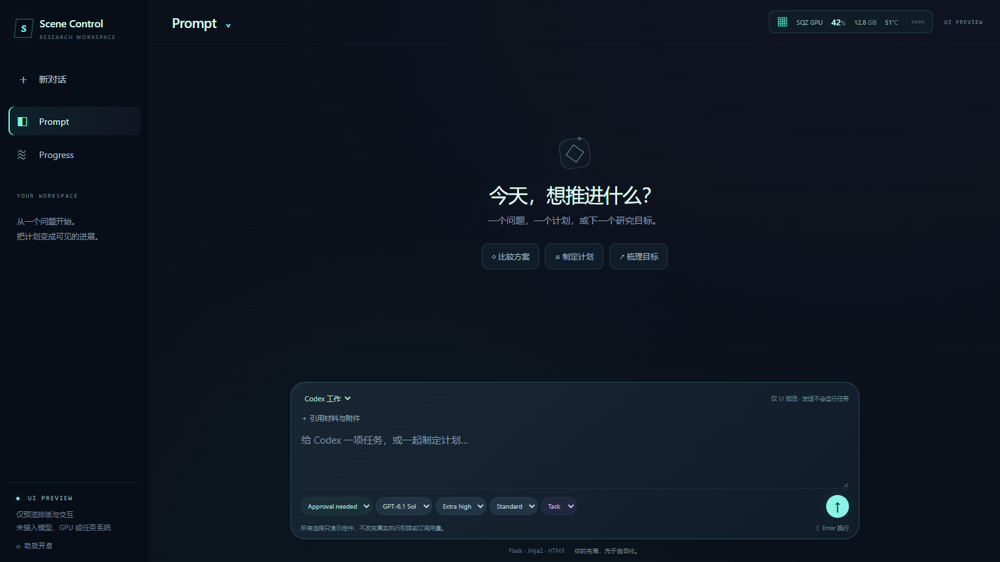

# UI-only preview



[Progress layout, synthetic data](preview-progress.png)

Flask 3.1 / Jinja2 templates / locally pinned HTMX 2.0.11 / small native JavaScript.
Cyberpunk styling on a chat layout; the sidebar owns Prompt / Progress navigation
and New chat, with a plain page title above. The compact GPU chip appears only in
Prompt and shows memory used / total plus percentage. Default controls: GPT-6.1
Sol, Extra high, Standard, Approval needed. Settings use upward opening popovers
with short opacity/scale transitions, keyboard navigation and Escape dismissal.

**All model, GPU, execution and review data here are illustrative.** Sending text
renders a template response. No CLI, SSH, research file, production queue, approval,
subscription or API is connected. Frontend layout changes do not require Claude
review under the user's explicit 2026-10-22 instruction. Backend integration remains
a later task after layout approval. The accepted orchestration service remains
unchanged. The existing **BGV Scene Control** desktop and Start menu entries can
now open this approved interface in the native **Scene Control** window:

```powershell
& 'E:\Github\Research-Agent-Orchestrator\tools\approved-ui.ps1' -Mode Install
& 'E:\Github\Research-Agent-Orchestrator\tools\approved-ui.ps1' -Mode Open
```

Installation backs up and verifies both owned original shortcuts. `-Mode Status`
shows their destinations; `-Mode Restore` restores the verified originals.
It does not replace the frozen worker/service snapshots or change scheduled
tasks. The window still clearly labels the current UI-only scope. Reopening
focuses the same UI window without clearing its draft.

From this configured machine, open the separate native preview:

```powershell
& 'E:\Github\Research-Agent-Orchestrator\ui_preview\Start-Preview.ps1'
```

The small existing-technology WebView2 shell displays the Flask interface as a
desktop window. The Flask server binds only 127.0.0.1:8877. No scheduled task is
installed; reopening after reboot starts only this preview server as needed. It
does not restart jobs or open an ordinary browser. `Start-Preview.ps1 -Desktop`
uses the installed-window title and a separate native shell; the default command
continues to open the explicitly named preview.

For a new checkout, create a project virtual environment and install
`ui_preview/requirements.txt`. Run `python -B ui_preview/app.py` to start the
renderer. The native helper reuses the configured machine's accepted WebView2
DLLs; it is not a portable installer. No global Python/auth settings are changed.

Templates: `ui_preview/templates/`. Styling: `ui_preview/static/style.css`.
Minor behavior: `ui_preview/static/ui.js`. Flask only returns Jinja-rendered HTML;
HTMX handles page swaps and demo message submission. The custom JavaScript retains
unsent drafts in memory, handles Enter/Shift+Enter, menus and motion. It stores no
drafts on disk. There is no React, React Native, SPA build or actual execution logic.

HTMX is vendored with its license and integrity metadata. Official references:
[Flask installation](https://flask.palletsprojects.com/en/stable/installation/),
[HTMX documentation](https://htmx.org/docs/). Development does not depend on a CDN.
